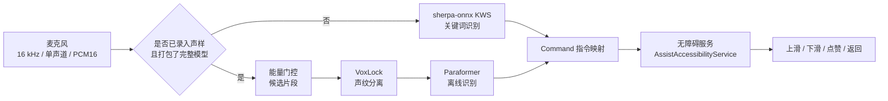

<div align="center">


# 随声刷 · DouyinAssistant

**刷抖音不用手：本地离线语音指令 + Android 无障碍手势**

[](https://developer.android.com)
[](https://kotlinlang.org)
[](https://developer.android.com/ndk/guides/abis)
[](LICENSE)
[](CONTRIBUTING.md)

[简体中文](README.md) · [English](README_EN.md)

</div>

> [!WARNING]
> 本项目仅供学习、研究与个人自动化使用，与抖音、字节跳动没有任何关联。使用自动化操作可能违反平台用户协议，并可能带来账号被限制的风险。请自行评估并控制使用频率，不要用于刷量、营销或其他违规用途。

---

## 简介

**随声刷**是一个 Android 端的抖音语音助手。它通过 Android 无障碍服务读取界面并执行手势，结合**完全运行在手机本地的语音识别**，让你在做饭、躺床上、手湿或手忙的时候，动动嘴就能完成：

- 「跳过」—— 上滑到下一个视频
- 「上滑 / 下一个」—— 下一个视频
- 「下滑 / 上一个」—— 上一个视频
- 「点赞」—— 双击点赞
- 「返回」—— 退出当前页面

不需要 root，不上传录音，不依赖云端 API。识别、声纹分离和手势执行都在本机完成。

项目最初是一个「躺着刷抖音不想抬手」的个人工具，后来逐步补上了关键词识别、声纹录入、悬浮窗、完整离线 ASR 和调试工具。代码和实验记录都保留在仓库里，欢迎参考、复刻或一起改进。

## 功能特性

| 能力 | 说明 | 状态 |
| --- | --- | --- |
| 语音手势 | 上滑、下滑、跳过、点赞、返回 | ✅ 可用 |
| 无障碍执行 | `dispatchGesture` 滑动、点击、全局返回，无需 root | ✅ 可用 |
| 本地关键词识别 | 基于 [sherpa-onnx](https://github.com/k2-fsa/sherpa-onnx) KWS，开箱即用 | ✅ 可用 |
| 声纹录入 | 「记住你的声音」约 10 秒，用于把口令从视频人声中分离 | ✅ 可用 |
| 完整离线 ASR | VoxLock 声纹分离 + Paraformer 中文识别，模型可选打入 | 🧪 实验特性 |
| 悬浮窗 | 在抖音上方实时显示识别文本 | ✅ 可用 |
| 调试工具 | 保存 PCM、应用日志、录音源 A/B、实验模式 | ✅ 可用 |
| 离线回放脚本 | 在电脑上复现手机录音的识别结果 | ✅ 可用 |
| 预编译 APK | 体积较大，暂未随仓库发布 | ⏳ 计划中 |

## 工作原理



### 两条识别路径

**1. 关键词识别（默认，开箱即用）**

`sherpa-onnx` 的 Zipformer KWS 模型随仓库打包。应用每 100 ms 读取一段 16 kHz 单声道 PCM，送入同一条 KWS 流；命中关键词后重置流并交给 `Command` 映射成手势。没有声样、没有完整模型时也能用，但在抖音外放、视频人声较大时准确率会下降。

**2. 完整识别（可选，实验特性）**

在打包了 VoxLock + Paraformer 模型，并且用户录入过声样时，应用会走完整 ASR：

1. 用 20 ms RMS 与 2.5 秒滑动中位数比较，切出比背景高 6 dB、高于 −50 dBFS、且至少有 120 ms 语音的候选片段；
2. 只把候选片段送入 VoxLock 做目标说话人分离，避免整段视频音频都过模型；
3. 对分离后的音频做 2 秒窗口、0.5 秒步长的 Paraformer 识别；
4. 命中「跳过」及导航短句后执行手势，并按触发窗口去重，避免一句话滑两次。

关键词识别继续负责上滑、下滑、点赞、返回；它自己听到的「跳过」会被忽略，防止重复执行。完整识别对性能要求较高，当前只在 arm64 真机上验证过，属于实验特性。

> 完整模型约有 154 MB，默认**不打进**仓库和 APK。启用方式见[可选：启用完整语音识别](#可选启用完整语音识别)。

### 执行链路

```
AssistSettingActivity
  → AssistAccessibilityService
    → KwsRecognitionService
      → KeywordSpotter / VoiceExperiment
        → CommandListener
          → AssistAccessibilityPerform
            → dispatchGesture / ACTION_CLICK / GLOBAL_ACTION_BACK
```

- **上滑 / 跳过 / 下一页**：从屏幕 80% 高度滑到 20% 高度，持续 300 ms。
- **下滑 / 上一页**：反向滑动。
- **点赞**：优先按资源 ID、内容描述查找点赞按钮，找不到时回退到右下角坐标点击。
- **返回**：调用无障碍全局返回。

## 快速开始

### 环境要求

| 项目 | 要求 |
| --- | --- |
| 系统 | Android 8.0（API 26）及以上 |
| CPU | arm64-v8a（暂不支持 32 位） |
| 内存 | 建议 4 GB 及以上 |
| 存储 | 安装包与模型约需 400 MB；开启 PCM 保存后每小时约 115 MB |
| 构建 | JDK 17、Android SDK Platform 33、NDK 25.2.9519653 |
| 设备 | 需要一台能开启无障碍服务的真机；模拟器未验证 |

### 构建 Debug APK

```bash
git clone https://github.com/Freshman111/DouyinAssistant.git
cd DouyinAssistant

# 指向本机 Android SDK
cp local.properties.example local.properties
# 编辑 local.properties，把 sdk.dir 改成你的 SDK 路径

export JAVA_HOME="$(/usr/libexec/java_home -v 17)"   # macOS
# Linux / Windows 请设置为你自己的 JDK 17 路径

./gradlew :app:assembleDebug
```

产物在：

```
app/build/outputs/apk/debug/app-debug.apk
```

Windows 使用 `gradlew.bat`。首次构建会下载 Gradle 7.3.3 和依赖，建议保持网络畅通；依赖已缓存时可加 `--offline`。

### 安装与首次使用

```bash
adb install -r app/build/outputs/apk/debug/app-debug.apk
```

1. 打开「随声刷」，点击 **打开无障碍设置**，在系统设置中启用「随声刷」无障碍服务。
2. 回到应用，点击 **检查服务状态**，确认已启用。
3. 点击 **开启语音**，授予麦克风权限。
4. 如果使用完整识别，先点 **录入我的声音**，按屏幕提示用平时说口令的音量说约 10 秒。
5. 打开抖音，进入视频播放页；再回到随声刷点 **开启语音**。
6. 对着手机说「跳过」「上滑」「点赞」等口令。
7. 需要看实时识别结果时，可开启 **悬浮窗**；不用时点 **关闭语音** 节省电量。

> 部分厂商系统会限制后台录音或杀掉无障碍服务。如遇到开启后无反应，请在系统设置中允许自启动、后台运行，并关闭针对本应用的电池优化。

### 关于签名

仓库**不包含**任何签名文件。`sign/douyin-assist-key.jks` 和 `local.properties` 中的密码都已被忽略。

- 没有自定义签名时：Debug 构建使用 Android 默认 debug keystore，可以直接安装。
- 想使用自己的签名：把 keystore 放到 `sign/douyin-assist-key.jks`，在 `local.properties` 写入 `sign_pasword=你的密码`。`app/build.gradle` 会自动启用该签名；别名默认是 `douyin-assist-alias`，也可以在 `app/build.gradle` 中修改。
- Release 构建在没有自定义签名时会回退到 debug 签名，正式分发前请换成自己的 release key。

**请勿把 keystore、密码、录音或日志提交到仓库。**

## 指令表

| 你说 | 执行 | 说明 |
| --- | --- | --- |
| 跳过 / 跳过吧 / 帮我跳过 / 你跳过 | 上滑 | 最高频指令；完整识别使用严格短句白名单 |
| 上滑 / 向上滑 / 向上滑动 | 上滑 | 下一个视频 |
| 下一个 / 下一条 / 下一个视频 / 下一条视频 / 翻页 / 下一页 | 上滑 | 导航类口令 |
| 下滑 / 向下滑 | 下滑 | 上一个视频 |
| 上一个 / 上一条 / 上一个视频 / 上一条视频 / 上一页 / 返回上页 | 下滑 | 导航类口令 |
| 点赞 / 喜欢 / 双击 | 点赞 | 优先点击点赞按钮，失败时坐标兜底 |
| 返回 / 退出 / 回去 | 返回 | 全局返回 |

说明：

- 关键词识别使用**子串匹配**，因此「这个跳过吧」也可能命中「跳过」。
- 完整识别的「跳过」使用**归一化后的整句白名单**，例如「跳过」「跳过吧」「你跳过」「帮我跳过呀」「请跳过」会命中；「跳过这段」「我想跳过」「快跳过」不会命中，以减少视频人声误触发。
- 完整识别还支持「下一个视频」「上一个视频」「前一个视频」「后一个视频」等导航短句；遇到这些词时关键词识别会让路，避免一次口令执行两次。

## 可选：启用完整语音识别

完整识别需要额外准备 4 个模型文件。它们不随仓库分发，原因主要是体积和上游模型许可；请从 [sherpa-onnx](https://github.com/k2-fsa/sherpa-onnx) 的发布页与文档获取，并遵守上游许可。

需要的文件：

| 文件 | 作用 | 约体积 |
| --- | --- | --- |
| `enroll.onnx` | VoxLock 声纹编码 | 12 MB |
| `chunk_int8.onnx` | VoxLock 语音分离 | 64 MB |
| `paraformer.int8.onnx` | Paraformer 中文离线识别 | 78 MB |
| `tokens.txt` | Paraformer 词表 | 76 KB |

目录结构：

```
voice-assets/
└── voice-experiment/
    ├── enroll.onnx
    ├── chunk_int8.onnx
    ├── paraformer.int8.onnx
    └── tokens.txt
```

构建时通过 `voiceExperimentAssets` 把该目录作为 Debug 的额外 assets：

```bash
./gradlew :app:assembleDebug \
  -PvoiceExperimentAssets="$PWD/voice-assets"
```

安装后：

1. 在设置页点 **录入我的声音**，安静环境下录约 10 秒；
2. 打开抖音外放，回到随声刷开启语音；
3. 先说「跳过」测试；如果日志里能看到 `VoiceExperiment ready` 和 `window ... text=跳过`，说明完整识别已生效。

相关文档：

- [真机构建与调试](doc/android-debug.md)
- [语音识别实验记录](doc/voice-recognition.md)
- [语音方案产品化评审稿](doc/asr-product-plan.md)
- [「记住你的声音」入口与录音脚本](doc/voice-sample-ux.md)

## 项目结构

```text
DouyinAssistant/
├── app/                    # 应用壳、设置页、无障碍服务、手势执行、调试页
├── biz-kws/                # 语音控制入口：录音、KWS、完整 ASR 实验、指令映射
├── biz-sherpa-onnx/        # sherpa-onnx Kotlin/JNI 绑定与 KWS 模型
├── biz-asr/                # Vosk Demo 与 ASR 基础设施
├── biz-overlay/            # 悬浮窗服务
├── router-asr/             # DRouter 路由
├── common/                 # 日志、调试开关、通用工具
├── models/                 # Vosk 中文小模型 assets
├── doc/                    # 构建、实验、产品化文档
├── tools/                  # 桌面端离线回放与日志分析脚本
├── gradle/                 # 版本与依赖配置
└── sign/                   # 本地签名目录（已忽略，不随仓库分发）
```

| 模块 | 职责 |
| --- | --- |
| `app` | `AssistSettingActivity` 负责权限与启停；`AssistAccessibilityService` 持有识别实例并把命令转成操作；`AssistAccessibilityPerform` 调用 `dispatchGesture`。 |
| `biz-kws` | `KwsRecognitionService` 是语音控制的录音与识别入口；`Command` 把识别文本映射成业务命令；`VoiceExperiment` 实现候选分段 + VoxLock + Paraformer。 |
| `biz-sherpa-onnx` | `KeywordSpotter` / `OnlineRecognizer` / `OfflineRecognizer` 等 Kotlin 绑定；预编译 JNI 与 ONNX Runtime 在 `libs/arm64-v8a/`。 |
| `biz-asr` | Vosk 相关 Demo 与 `vosk-lib-release.aar`。 |
| `biz-overlay` | `FloatWindowService`，在抖音上方显示实时识别结果。 |
| `common` | `DebugCache`、`LogUtil`、`FileLogWriter` 等。 |
| `router-asr` | DRouter 路由声明。 |
| `models` | Vosk 中文小模型资源。 |

## 技术栈

| 层次 | 选型 |
| --- | --- |
| 语言 | Kotlin 2.0 |
| 构建 | Gradle 7.3.3、AGP 7.2.2 |
| 最低版本 | Android 8.0（API 26）、targetSdk 33 |
| 语音识别 | [sherpa-onnx](https://github.com/k2-fsa/sherpa-onnx) 2.0.1、ONNX Runtime、Zipformer KWS、Paraformer、VoxLock |
| 传统 ASR | [Vosk](https://github.com/alphacep/vosk-api)（Demo/实验） |
| UI | AndroidX、Material Components、ViewBinding、Material Dialogs |
| 路由 | [DRouter](https://github.com/didi/DRouter) |
| 手势 | Android AccessibilityService、`dispatchGesture` |

## 调试与实验

调试入口在设置页的 **调试**，可以独立开关：

- **保存音频文件**：把语音会话的 PCM 写到应用缓存，16 kHz、单声道、16 位小端、无 WAV 头。
- **保留应用日志**：把日志写到 `files/logs`，最多轮转 3 个文件，每个约 2 MiB。
- **使用语音识别录音源（B）**：在 `VOICE_COMMUNICATION`（A）与 `VOICE_RECOGNITION`（B）之间切换。
- **语音实验（录音对照）**：只录音、不执行，用于对比离线结果。

导出：

```bash
capture_dir="$(mktemp -d "${TMPDIR:-/tmp}/douyin-capture.XXXXXX")"
adb pull /sdcard/Android/data/com.sgffsg.douyin.assist/cache/Audio "$capture_dir/"
adb pull /sdcard/Android/data/com.sgffsg.douyin.assist/files/logs "$capture_dir/"

cd "$capture_dir/Audio"
ffmpeg -f s16le -ar 16000 -ac 1 -i input.pcm output.wav
```

`tools/` 里提供了三个桌面脚本：

| 脚本 | 用途 |
| --- | --- |
| `replay_voice.py` | 用同一段 PCM 回放 KWS / SenseVoice / Paraformer，输出逐窗结果和摘要。 |
| `replay_gated.py` | 复现候选分段 + VoxLock + Paraformer，可比较多段声样和输入增益。 |
| `summarize_experiment_log.py` | 汇总应用日志里的 `ready` / `window` / `overrun` / `stop`，计算实时系数和积压。 |

完整步骤、参数和实验结果见 [doc/voice-recognition.md](doc/voice-recognition.md) 与 [doc/android-debug.md](doc/android-debug.md)。

## 隐私与权限

| 权限 | 用途 |
| --- | --- |
| `RECORD_AUDIO` | 语音识别与声样录入 |
| `BIND_ACCESSIBILITY_SERVICE` | 执行滑动、点赞、返回 |
| `SYSTEM_ALERT_WINDOW` | 悬浮窗 |
| `FOREGROUND_SERVICE` | 悬浮窗/录音相关前台服务 |
| `INTERNET` / `ACCESS_NETWORK_STATE` | 应用声明了网络权限，但语音识别和手势均在本地完成，仓库代码中没有上传音频的网络请求 |
| `WRITE_EXTERNAL_STORAGE` | Android 9 及以下的调试音频导出 |

- **不上传录音**：语音识别、声纹分离、模型推理全部在本机完成。
- **无账号、无统计、无广告**：应用不要求登录，也没有接入分析或广告 SDK。
- **本地数据**：声样保存在应用私有的 `no_backup` 目录；PCM 和日志只在调试开关打开时写入，可随时在系统设置中清除应用数据。
- **无障碍披露**：无障碍服务用于读取当前界面并执行手势，不收集个人信息。首次启用时系统会展示服务说明。

## 已知限制

- **仅 arm64-v8a**：仓库内只有 arm64 的 JNI 库，32 位设备无法运行。
- **完整识别是实验特性**：需要额外模型和声样，在 iQOO 12 / Android 14 上验证；其他机型、系统版本和抖音版本需要自行测试。
- **外放场景仍有挑战**：视频人声、音量、房间混响都会影响识别。作者的真机体感约 70–80%，受控测试中「跳过」可到 8/10–12/12，具体数据见实验文档。
- **点赞依赖界面结构**：优先按资源 ID 和内容描述查找点赞按钮，抖音改版后可能失效，此时回退到坐标点击，可能误点。
- **后台录音限制**：Android 11+ 对后台麦克风有约束，部分厂商系统还会限制自启动/后台运行；能否在抖音前台时稳定录音取决于机型。
- **持续监听耗电**：语音控制开启后会持续读取麦克风，长时间使用建议接电源或及时关闭。
- **安装包较大**：内置 Vosk 65 MB、KWS 12 MB、JNI/ONNX Runtime 26 MB；完整模型再加 154 MB。首次下载和安装需要预留空间。
- **没有预编译 APK**：请按上面的步骤自行构建；欢迎在 Issues 中反馈机型和构建问题。

## 路线图

- [x] 关键词识别 + 无障碍手势
- [x] 声纹录入与质量检查
- [x] VoxLock + Paraformer 候选分段完整识别
- [x] 悬浮窗实时识别结果
- [x] 离线回放与日志分析脚本
- [ ] 首启性能自检与自动降级
- [ ] 更多指令统一到完整 ASR
- [ ] 更小的模型 / 首次启动按需下载
- [ ] 补充截图、演示 GIF 与英文文档
- [ ] 增加单元测试与更多机型兼容性验证

## 常见问题

<details>
<summary><b>需要 root 吗？</b></summary>

不需要。应用使用 Android 无障碍服务执行手势，只需要在系统设置中手动启用。

</details>

<details>
<summary><b>会上传我的录音吗？</b></summary>

不会。语音识别和声纹分离都在手机本地完成，仓库代码中没有上传音频的网络请求。PCM 和日志只有在调试开关打开时才会写到本机。

</details>

<details>
<summary><b>为什么说「跳过」有时没反应？</b></summary>

先检查无障碍服务和麦克风权限是否开启，再确认抖音前台时应用没有被系统限制后台录音。使用完整识别时，建议重新录一次声样，并尽量用短句、保持正常音量。外放音量过大或视频人声密集时，识别率会下降，具体可参考 [语音识别实验记录](doc/voice-recognition.md)。

</details>

<details>
<summary><b>为什么安装包这么大？</b></summary>

内置了 Vosk 中文模型（约 65 MB）、KWS 模型（约 12 MB）和 JNI/ONNX Runtime（约 26 MB）。如果启用完整识别，还要再加约 154 MB 的 VoxLock + Paraformer 模型。后续会探索按需下载和更小的模型。

</details>

<details>
<summary><b>支持其他 App 吗？</b></summary>

滑动和返回是通用手势，理论上可以用于其他可滑动页面；点赞逻辑针对抖音的界面结构做了适配，换 App 需要修改 `AssistAccessibilityScan` 和 `Command`。欢迎提交适配 PR。

</details>

<details>
<summary><b>支持 iOS / 32 位手机 / Android 8 以下吗？</b></summary>

都不支持。无障碍服务、JNI 库和模型都是按 Android arm64 准备的；iOS 需要完全不同的实现。

</details>

<details>
<summary><b>使用会被封号吗？</b></summary>

无法保证。自动化操作可能违反平台规则，请控制频率、不要用于刷量或营销，并自行承担风险。本项目与抖音官方无关。

</details>

## 参与贡献

欢迎 Issue、PR、机型和抖音版本适配反馈。

1. Fork 仓库，从 `main` 新建分支，例如 `feat/xxx` 或 `fix/xxx`。
2. 保持 Kotlin 官方代码风格，提交前至少跑通 `./gradlew :app:assembleDebug`。
3. 涉及识别逻辑的改动，请在真机上测试，并尽量附上设备型号、Android 版本、抖音版本和复现步骤。
4. 不要提交 keystore、密码、`local.properties`、录音、PCM 或日志。
5. 提交 PR 时说明改动目的、测试方式和影响范围。

更多约定见 [CONTRIBUTING.md](CONTRIBUTING.md)。

## 许可证

本项目采用 [Apache License 2.0](LICENSE) 开源。

Copyright 2026 Freshman111

第三方组件与模型的许可信息见 [NOTICE](NOTICE)。其中 sherpa-onnx、Vosk、Vosk 中文模型、DRouter、Material Dialogs 等使用 Apache-2.0；ONNX Runtime 使用 MIT。完整模型和 KWS 模型由上游发布，使用前请阅读对应模型页面的许可说明。

## 致谢

- [sherpa-onnx](https://github.com/k2-fsa/sherpa-onnx) —— 离线语音识别、关键词识别、VoxLock 与 Paraformer 推理
- [Vosk](https://github.com/alphacep/vosk-api) 与 [Vosk 中文小模型](https://alphacephei.com/vosk/models)
- [ONNX Runtime](https://github.com/microsoft/onnxruntime)
- [DRouter](https://github.com/didi/DRouter)
- [Material Dialogs](https://github.com/afollestad/material-dialogs)
- AndroidX、Material Components 与所有为本项目提供灵感与工具的开源项目

---

<div align="center">

如果这个项目对你有帮助，欢迎点一个 ⭐ Star；有想法也欢迎开 Issue 一起讨论。

</div>
