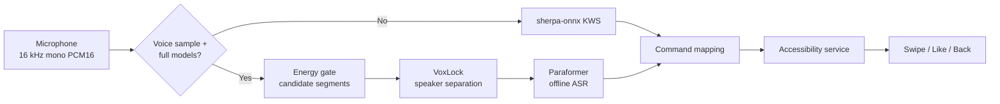

<div align="center">


# DouyinAssistant · 随声刷

**Hands-free Douyin: on-device voice commands + Android accessibility gestures**

[](https://developer.android.com)
[](https://kotlinlang.org)
[](https://developer.android.com/ndk/guides/abis)
[](LICENSE)

[简体中文](README.md) · [English](README_EN.md)

</div>

> [!WARNING]
> This project is for learning, research, and personal automation only. It is not affiliated with Douyin or ByteDance. Automated interaction may violate the platform's terms of service and may put your account at risk. Use it at your own discretion.

## What is it?

DouyinAssistant is an Android voice assistant for Douyin (the Chinese version of TikTok). It uses an Android accessibility service to read the screen and perform gestures, and runs speech recognition entirely on the phone. You can say:

| You say | Action |
| --- | --- |
| 跳过 (skip) | Swipe up to the next video |
| 上滑 / 下一个 (swipe up / next) | Next video |
| 下滑 / 上一个 (swipe down / previous) | Previous video |
| 点赞 (like) | Double-tap like |
| 返回 (back) | Go back |

No root, no cloud API, no audio upload. The app is designed for Chinese voice commands, with Kotlin/Android source and engineering notes in Chinese.

## Features

- **On-device keyword spotting** via [sherpa-onnx](https://github.com/k2-fsa/sherpa-onnx), works out of the box.
- **Voice enrollment**: a ~10 s sample lets VoxLock separate your voice from video audio.
- **Optional full ASR**: VoxLock + Paraformer, with energy-gated candidate segments. Experimental; models are not bundled.
- **Accessibility gestures**: swipe, like, and global back without root.
- **Floating window** showing live recognition text.
- **Debug tools**: PCM capture, file logs, audio-source A/B, offline replay scripts.

## How it works



The default path uses a bundled Zipformer KWS model and is enough to try the app. The optional full-ASR path requires 154 MB of VoxLock + Paraformer models. See [README.md](README.md) for the detailed Chinese documentation, model setup, tuning notes, and experiment results.

## Build

Requirements: JDK 17, Android SDK Platform 33, NDK 25.2.9519653, an arm64 Android 8.0+ device.

```bash
git clone https://github.com/Freshman111/DouyinAssistant.git
cd DouyinAssistant

cp local.properties.example local.properties
# edit sdk.dir

export JAVA_HOME="$(/usr/libexec/java_home -v 17)"   # macOS
./gradlew :app:assembleDebug

adb install -r app/build/outputs/apk/debug/app-debug.apk
```

The repository contains no signing key. Without `sign/douyin-assist-key.jks`, Gradle falls back to the default debug keystore. See [README.md](README.md#关于签名) for custom signing.

### Optional full ASR

Put the models under a directory like this:

```text
voice-assets/
└── voice-experiment/
    ├── enroll.onnx
    ├── chunk_int8.onnx
    ├── paraformer.int8.onnx
    └── tokens.txt
```

Then build with:

```bash
./gradlew :app:assembleDebug -PvoiceExperimentAssets="$PWD/voice-assets"
```

Models are available from the [sherpa-onnx releases and documentation](https://github.com/k2-fsa/sherpa-onnx). Follow the upstream model licenses.

## Usage

1. Open the app and enable its accessibility service in system settings.
2. Grant microphone permission.
3. (Optional) Tap **录入我的声音** and record a ~10 s sample.
4. Open Douyin, play a video, then return to the app and tap **开启语音**.
5. Say a command. Enable the floating window if you want to see recognition results.
6. Turn voice control off when you are done to save battery.

## Privacy

- Recognition, speaker separation, and gesture execution run locally.
- No account, analytics, or ads.
- Voice samples are stored in the app-private `no_backup` directory.
- PCM and logs are written only when debug switches are enabled.
- The manifest declares `INTERNET`, but the code does not upload audio.

## Limitations

- arm64-v8a only; Android 8.0+.
- Full ASR is experimental and device-dependent (tested on iQOO 12 / Android 14).
- Recognition accuracy drops with loud playback, overlapping speech, and background noise.
- The like button lookup is tied to Douyin's accessibility tree and may break after app updates.
- Background microphone behavior depends on the OEM and Android version.

## Contributing

Issues and PRs are welcome. Please run `./gradlew :app:assembleDebug` before submitting, describe your device/Android/Douyin version, and never commit keystores, passwords, recordings, or logs. See [CONTRIBUTING.md](CONTRIBUTING.md).

## License

[Apache License 2.0](LICENSE), Copyright 2026 Freshman111. Third-party notices are in [NOTICE](NOTICE).

## Acknowledgements

[sherpa-onnx](https://github.com/k2-fsa/sherpa-onnx) · [Vosk](https://github.com/alphacep/vosk-api) · [ONNX Runtime](https://github.com/microsoft/onnxruntime) · [DRouter](https://github.com/didi/DRouter) · [Material Dialogs](https://github.com/afollestad/material-dialogs) · AndroidX

---

<div align="center">If this project helps you, a ⭐ is appreciated.</div>
